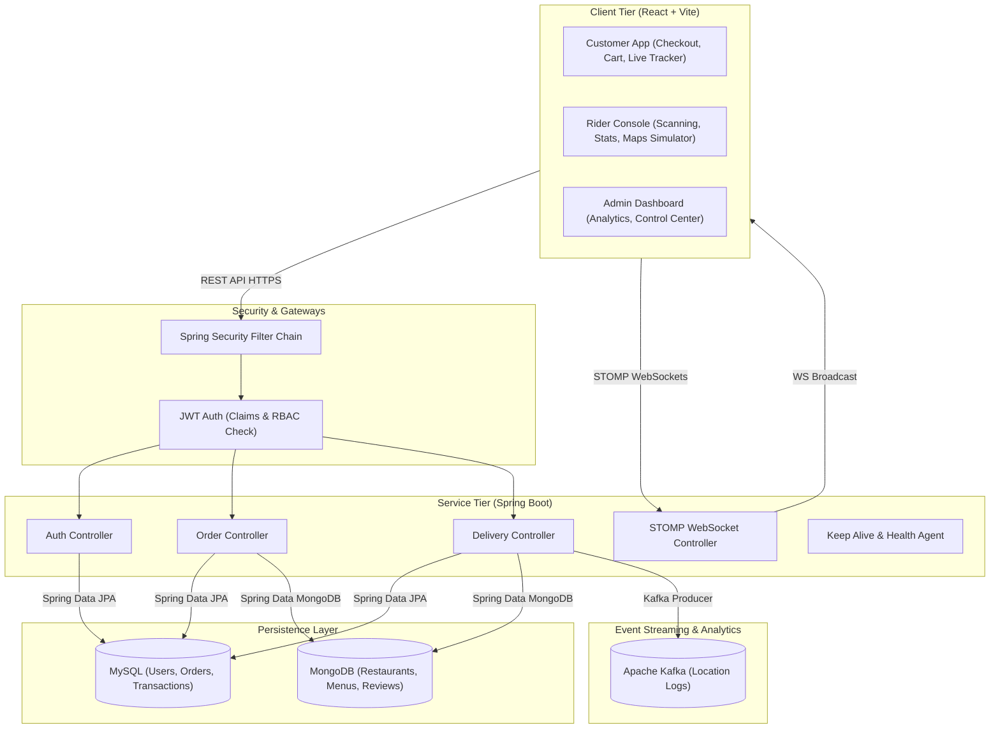
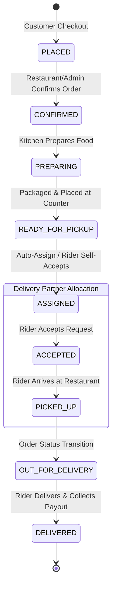

# 🍔 Tomato: Production-Grade Food Delivery Platform

Tomato is a high-performance, production-grade food delivery application modeled after industry giants like Zomato and Swiggy. It features a complete end-to-end flow from order placement to real-time tracking, a modern glassmorphic UI, and dedicated dashboards for Customers, Riders, and Admins.

---

## 🏗️ System Architecture

Tomato is built on a distributed, multi-database architecture designed for transaction safety and high-throughput read operations.



---

## 🚴 Order & Delivery Lifecycle

The system coordinates order status and delivery partner tracking status across a synchronized state machine:



---

## 🛠️ Technology Stack

| Layer | Frontend (React App) | Backend (Spring Boot API) |
|---|---|---|
| **Core** | React 19, Vite, Javascript | Java 17, Spring Boot 3.2 |
| **Security** | Zustand Auth Persistence, JWT interceptors | Spring Security 6, JWT, Role-Based Access Control |
| **Styling** | Tailwind CSS 4, Framer Motion, HSL palettes | Lombok, MapStruct (DTO Mapping) |
| **Database** | — | MySQL 8 (Transactional), MongoDB Atlas (Catalog/Menus) |
| **Real-time** | SockJS, Stompjs WebSocket Clients | STOMP Message Broker (In-Memory / Kafka integration) |
| **Maps & GPS** | Leaflet.js, React-Leaflet | Live GPS Coordinates broadcast agent |
| **Analytics** | Recharts (Responsive charts) | Daily Sales aggregation, Rider weekly payouts |

---

## 🚦 Role-Based Authorization matrix

The system enforces strict Spring Security roles: `ROLE_CUSTOMER`, `ROLE_DELIVERY_PARTNER`, and `ROLE_ADMIN`.

| API Endpoint Group | Customer | Rider | Admin | Public |
|---|:---:|:---:|:---:|:---:|
| `POST /api/auth/**` | ✅ | ✅ | ✅ | ✅ (No Token) |
| `GET /api/restaurants/**` | ✅ | ✅ | ✅ | ✅ (No Token) |
| `POST/PUT/DELETE /api/restaurants` | ❌ | ❌ | ✅ | ❌ |
| `GET /api/menu/**` | ✅ | ✅ | ✅ | ✅ (No Token) |
| `POST/PUT/DELETE /api/menu/**` | ❌ | ❌ | ✅ | ❌ |
| `ALL /api/cart/**` | ✅ | ❌ | ❌ | ❌ |
| `POST /api/orders` | ✅ | ❌ | ❌ | ❌ |
| `GET /api/orders/my` | ✅ | ❌ | ❌ | ❌ |
| `GET /api/orders/{id}` | ✅ (Own) | ✅ (Assigned) | ✅ | ❌ |
| `GET /api/delivery/partner/available` | ❌ | ✅ | ❌ | ❌ |
| `POST /api/delivery/partner/order/*/accept` | ❌ | ✅ | ❌ | ❌ |
| `POST /api/delivery/partner/order/*/pickup` | ❌ | ✅ | ❌ | ❌ |
| `POST /api/delivery/partner/order/*/deliver` | ❌ | ✅ | ❌ | ❌ |

---

## 🚀 Key Features Explored

### 1. Expired JWT Authentication Entrypoint
* **The Problem**: Default Spring Security returned a `403 Forbidden` for expired JWT tokens, preventing frontend interceptors from distinguishing between "Expired credentials" (401) and "Forbidden roles" (403).
* **The Solution**: Configured an explicit `HttpStatusEntryPoint(HttpStatus.UNAUTHORIZED)` in `SecurityConfig.java`. When a JWT expires, the server immediately returns a `401 Unauthorized`. The frontend Axios response interceptor intercepts this, displays a toast, clears the session, and redirects to `/login`.

### 2. Premium Rider Console
* **Offline/Online Radar**: A custom status switcher. Switching online plays a Web Audio API chime sound, starts a polling loop, and shows a pulsing radar wave.
* **Available Delivery Runs**: Lists all pending orders in Noida/Delhi ready for pickup. Riders can self-accept an order directly.
* **Live Route Map**: Embedded Leaflet.js map with custom pins for Restaurant, Customer, and Rider.
* **Live Location Simulator**: Once picked up, riders can toggle a simulator which moves their GPS coordinates step-by-step from the restaurant to the customer. Updates are pushed via REST/WebSockets to the server.
* **Weekly Earnings Analytics**: Built using Recharts, displaying weekly income, tips, rating bonuses, and instant cash-out functionality.

### 3. Real-time Customer Live Tracking
* **Leaflet Engine Integration**: Upgraded the customer tracking map to Leaflet, removing Google Maps dependencies.
* **Dynamic ETA & Distance**: Pings `/topic/location/{orderId}` to receive live coordinates. It uses the Haversine formula on the client-side to calculate remaining distance and dynamically countdown the ETA as the rider drives.

---

## 📁 Repository Layout

```
food_delivery/
├── foodDelivery/               # Backend (Spring Boot Project)
│   ├── src/main/java/com/delivery/foodDelivery/
│   │   ├── config/             # Spring Security, CORS, WebSockets config
│   │   ├── controller/         # REST API Handlers (Auth, Order, Delivery...)
│   │   ├── entity/             # MySQL JPA entities & MongoDB Documents
│   │   ├── repository/         # Spring Data repositories
│   │   ├── service/            # Business Logic implementation
│   │   └── websocket/          # WebSocket controllers & STOMP interceptors
│   ├── pom.xml                 # Maven Dependencies
│   └── Dockerfile              # Docker Container configuration
│
└── foodDeliveryFrontend/       # Frontend (React + Vite Project)
    ├── src/
    │   ├── components/         # Reusable UI (common, order, layout)
    │   │   └── order/LiveMap.jsx # Upgraded Leaflet Live Tracker
    │   ├── pages/              # Routing pages
    │   │   ├── DeliveryDashboard.jsx # Sleek Rider Console
    │   │   ├── DeliveryPartnerCTA.jsx # Onboarding Landing page
    │   │   └── OrderDetail.jsx # Customer tracking screen
    │   ├── services/           # Backend API call clients
    │   └── store/              # Zustand global state persistence
    ├── tailwind.config.js      # Styling configuration
    └── package.json            # NPM dependencies
```

---

## ⚙️ Setup & Installation

### Prerequisite Services
Ensure you have the following installed and running locally:
1. **MySQL Server** (running on port `3306`)
2. **MongoDB Database** (Atlas cloud URI or local running on `27017`)
3. **Java 17 SDK**
4. **NodeJS** (version `18+` or higher)

### 1. Database Initialization
Execute the following commands in MySQL to set up the database and permissions:
```sql
CREATE DATABASE food_delivery_db CHARACTER SET utf8mb4 COLLATE utf8mb4_unicode_ci;
CREATE USER 'root'@'localhost' IDENTIFIED BY 'pop99558$$';
GRANT ALL PRIVILEGES ON food_delivery_db.* TO 'root'@'localhost';
FLUSH PRIVILEGES;
```

### 2. Backend Environment Config
Create/edit `foodDelivery/foodDelivery/src/main/resources/application.properties`:
```properties
server.port=8080
server.servlet.context-path=/api

# MySQL Configuration
spring.datasource.url=jdbc:mysql://localhost:3306/food_delivery_db?createDatabaseIfNotExist=true&useSSL=false&serverTimezone=UTC&allowPublicKeyRetrieval=true
spring.datasource.username=root
spring.datasource.password=pop99558$$
spring.datasource.driver-class-name=com.mysql.cj.jdbc.Driver

# MongoDB Configuration
spring.data.mongodb.uri=mongodb+srv://<username>:<password>@cluster0.mongodb.net/food_delivery_db

# Security
app.jwt.secret=404E635266556A586E3272357538782F413F4428472B4B6250645367566B5970
app.jwt.expiration-ms=604800000
```

### 3. Frontend Environment Config
Create `foodDeliveryFrontend/.env`:
```env
VITE_API_BASE_URL=http://localhost:8080/api
VITE_WS_URL=http://localhost:8080/api/ws
VITE_CLOUDINARY_CLOUD_NAME=dq7lolx67
VITE_CLOUDINARY_UPLOAD_PRESET=tomato_preset
VITE_GOOGLE_CLIENT_ID=226518503812-4qc0792uvv37fi3s2ropkds2tuhv18nj.apps.googleusercontent.com
```

---

## 🏃 Launching the Application

### Step A: Run Backend Server
Open a terminal inside the backend directory `foodDelivery/foodDelivery` and run:
```powershell
# Clean build dependencies
.\mvnw clean install -DskipTests

# Start Spring Boot application
.\mvnw spring-boot:run
```
The server will start listening at `http://localhost:8080/api`. You can ping `http://localhost:8080/api/health/ping` to verify status.

### Step B: Run Frontend App
Open a terminal in the frontend directory `foodDeliveryFrontend` and run:
```bash
# Install NPM packages
npm install

# Start Vite server
npm run dev
```
Open your browser and navigate to `http://localhost:5173` (or the fallback port indicated in the terminal, such as `http://localhost:5174/`).

---

## 🧪 Quick Test Flow (Customer to Rider)
1. **Sign Up**: Go to the signup page, select **Rider** to register as a Delivery Executive. Register another account as **Customer**.
2. **Order**: Log in as a customer, add items to the cart from any restaurant, checkout, and place an order.
3. **Accept**: Log in as your Rider. Toggle status to **Online**. Under the **Console** tab, you will see the new order request. Click **Accept Request**.
4. **Simulate**: Drive to the restaurant, click **Mark as Picked Up**, and toggle **Live Tracking Simulator**.
5. **Track**: Log in as a customer, click on your profile -> **Orders** -> **Track Order** to watch the rider move live on the customer map tracking console.
6. **Complete**: Mark as **Delivered** in the Rider Console to cash out.
